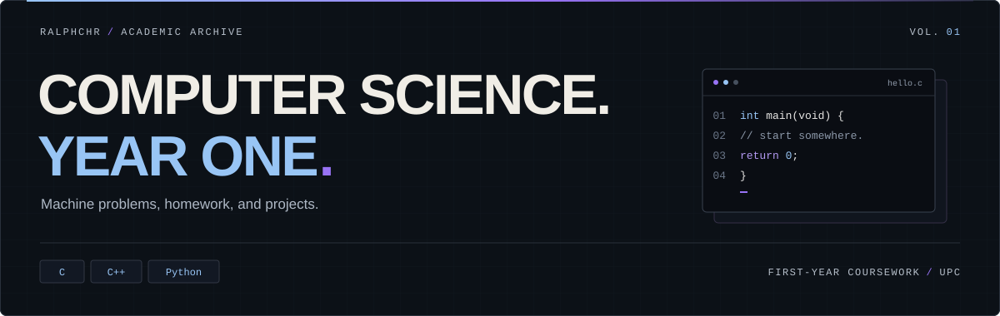
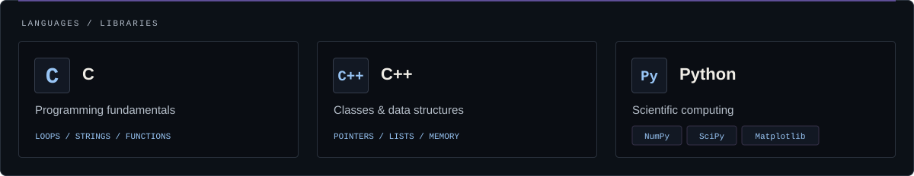
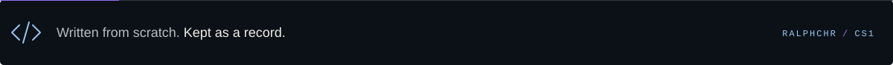

<div align="center">
  
</div>

<p align="center">
  <a href="#coursework">Coursework</a> &nbsp; / &nbsp;
  <a href="#toolkit">Toolkit</a> &nbsp; / &nbsp;
  <a href="#field-notes">Field notes</a>
</p>

A collection of machine problems, exercises, homework, and projects from my first year as a **Computer Science student at UPC**. From the first loops to linked lists, this is where I worked through the fundamentals, one problem at a time.

<a name="coursework"></a>

## `01 /` Coursework

| | Collection | Focus | Stack |
| :--- | :--- | :--- | :--- |
| `01` | **[CMSC 11](CMSC%2011/)** | Programming fundamentals · number problems · strings · small games | `C` |
| `02` | **[CMSC 21](CMSC%2021/)** | Recursion · pointers · dynamic memory · linked lists · classes | `C` `C++` |
| `03` | **[Physics homework](Physics%20Projectile%20Homework.py)** | Motion with and without air resistance · numerical integration · plots | `Python` |

### A few stops along the way

| Problem / project | What I worked on |
| :--- | :--- |
| **[Flame it on the Gene](CMSC%2011/Flame%20it%20on%20the%20Gene.c)** | String handling through FLAMES and gene-sequence matching. |
| **[The Polynomial Has Many Faces](CMSC%2021/MP%2010%20The%20Polynomial%20has%20many%20Faces.c)** | Representing polynomials with linked lists and implementing arithmetic operations. |
| **[I Am, First and Foremost, a STUDENT](CMSC%2021/MP%2011%20I%20am,%20first%20and%20foremost,%20a%20STUDENT.c)** | Managing student records with structures and linked lists. |
| **[Classy List](CMSC%2021/MP%20Classy%20List.cpp)** | Reimplementing a doubly linked list as a C++ class. |

<a name="toolkit"></a>

## `02 /` Toolkit



<a name="field-notes"></a>

## `03 /` Field notes

The solutions here are my own work, written from scratch as part of my first-year CS journey. They reflect my understanding and problem-solving approach **at the time I wrote them**. Some are rough around the edges; that's part of the record.

<details>
<summary><strong>Run an exercise</strong></summary>

Each source file is a standalone program. Compile and run the one you want to explore; check its comments and input handling for the expected input format. Use GCC for C, G++ for C++, or Python 3 for the physics homework.

**C** — from the repository root:

```sh
gcc "CMSC 11/Problem D - Factorial.c" -o factorial
```

**C++** — from the repository root:

```sh
g++ "CMSC 21/MP Classy List.cpp" -o classy-list
```

Run the resulting executable (`./factorial` or `./classy-list` on macOS/Linux; `.\factorial.exe` or `.\classy-list.exe` in Windows PowerShell).

**Python** — install the plotting and scientific-computing libraries, then run:

```sh
python -m pip install numpy scipy matplotlib
python "Physics Projectile Homework.py"
```

</details>

<br>


